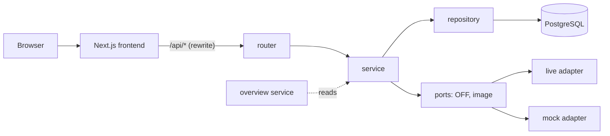
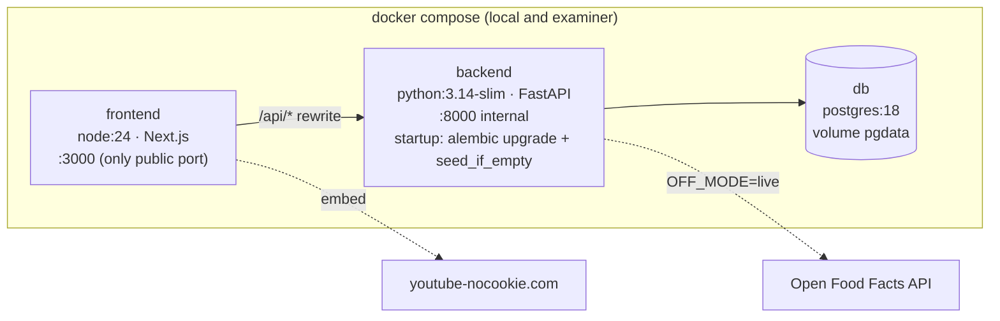
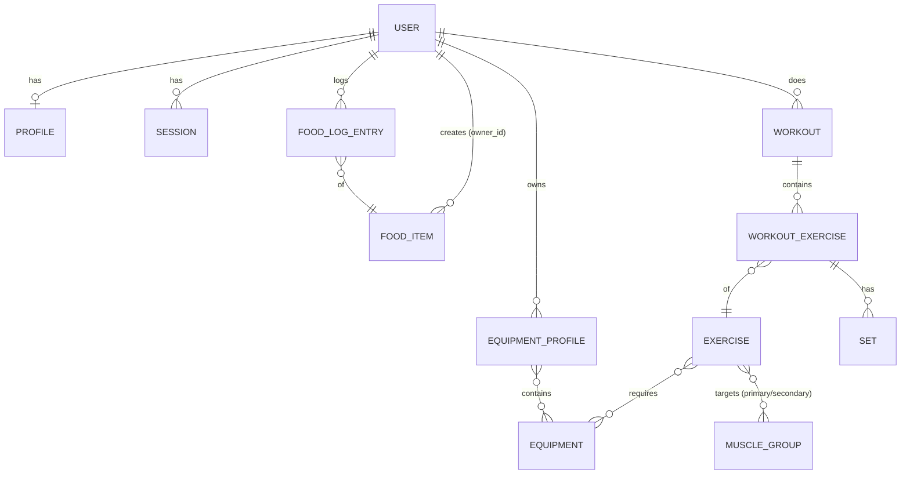

# Architecture Spine — Prompt Force

## Design Paradigm

**Modular monolith with layered feature modules.** One FastAPI backend holds all business rules and data; one Next.js frontend is a UI client of its HTTP API. Each feature is a module with the same three layers, and the same module names are used in both apps.

| Layer | Backend (`backend/app/modules/<module>/`) | Frontend (`frontend/src/modules/<module>/`) |
| --- | --- | --- |
| Interface | `router.py` — HTTP endpoints, request/response schemas | `pages` and `components` — UI only |
| Rules | `service.py` — business rules as plain functions | — (none; see AD-5) |
| Data | `repository.py` + `models.py` — SQLAlchemy | `api.ts` — generated client calls |

Modules: `identity` (account, session, consent), `profile` (body data, calorie target), `food` (food items, food log), `exercises` (catalog, equipment profiles, suggestions), `workouts` (workouts, sets, last time), `overview` (daily overview, read-only composition). Cross-module code lives in `backend/app/core/` (config, db session, auth dependency, errors) and `frontend/src/lib/`.

## Invariants & Rules



A layer may only call the layer to its right. `overview` may call other modules' services, never their repositories. No module imports another module's repository or models.

### AD-1 — Next.js is a UI client only [ADOPTED]

- **Binds:** all
- **Prevents:** business rules or data access split across two codebases and two languages.
- **Rule:** the frontend never connects to the database and never decides a value that is stored or shown as truth. All reads and writes go through the backend HTTP API.

### AD-2 — Single origin through a Next.js rewrite

- **Binds:** FR-1, NFR-1, NFR-3
- **Prevents:** CORS setups, cookies scoped to the wrong host, and two public URLs.
- **Rule:** the browser only talks to the frontend. `frontend` rewrites `/api/*` to the backend inside the Docker network. The backend is not exposed publicly. Caddy (HTTPS) is added only if FR-8 camera scanning is built.

### AD-3 — Server-side sessions, not JWT

- **Binds:** FR-1, FR-3, FR-4
- **Prevents:** two incompatible auth mechanisms, and sessions that survive logout or account deletion.
- **Rule:** login creates a random opaque token stored hashed in a `sessions` table and sent as an `HttpOnly`, `Secure`, `SameSite=Lax` cookie. Passwords use Argon2id. Failed logins are counted per account in the database (5 within 15 min → locked for 15 min) with one generic error message. Every mutating request (POST, PUT, PATCH, DELETE) must carry an `Origin` header matching the app URL. Logout and account deletion delete the user's sessions. A `require_consent` dependency (owned by `identity`) guards every endpoint that reads or writes health data; it rejects users without `consent_at` (FR-2). No module checks consent on its own.

### AD-4 — Ownership is enforced in the repository

- **Binds:** FR-3, FR-4, FR-12
- **Prevents:** one endpoint forgetting the owner filter and leaking another user's data.
- **Rule:** every user-owned table has `user_id`. Services get the current user from the auth dependency. No endpoint accepts a `user_id` from the client. Every repository read and write of user-owned data filters by `user_id`. Shared food items (Open Food Facts, Matvaretabellen) have `owner_id = NULL`; user-created ones have `owner_id` set and are only visible to that user.

### AD-5 — Business rules live in backend services, as pure tested functions

- **Binds:** FR-6, FR-13, FR-19, FR-20, FR-24, FR-26, NFR-8
- **Prevents:** the frontend and backend computing calorie targets, sums or suggestions differently.
- **Rule:** calorie target, kcal sums, exercise suggestions and «last time» are computed only in backend services, as functions without I/O, each with unit tests from the PRD's examples. Each rule has one owning module: `profile` owns the calorie target, `food` owns kcal per entry, per meal and per date, `exercises` owns suggestions, `workouts` owns «last time». `overview` only composes these through the owning services and never recomputes them. The frontend may show a live kcal preview while typing (FR-13), but what is saved and shown afterwards comes from the API.

### AD-6 — Food log entries snapshot the nutrition value

- **Binds:** FR-13, FR-15, FR-26
- **Prevents:** history changing when a cached food item is updated or re-fetched.
- **Rule:** a food log entry stores `grams` and `kcal_per_100g_snapshot` copied at logging time. Its kcal is always `grams × snapshot / 100`. Editing an entry changes grams or meal, never the snapshot.

### AD-7 — External services sit behind ports with live and mock adapters

- **Binds:** FR-8 – FR-10, FR-29, NFR-3, NFR-5, NFR-6
- **Prevents:** code calling Open Food Facts (or, in phase 2, an image model) directly, which breaks tests and running without keys or network.
- **Rule:** each external service is an interface in `backend/app/ports/` with a `live` and a `mock` adapter, chosen by environment (`OFF_MODE=live|mock`, `IMAGE_MODE=mock|live`, image defaults to mock). Automated tests always use mock. The Open Food Facts adapter: validates EAN-8/EAN-13 (length and check digit) before calling; looks up the local `food_items` cache first; sends the app's own User-Agent; keeps under 15 lookups per minute; caches every product found; treats HTTP 404 as «not found», never as an error.

### AD-8 — PostgreSQL is the only store; Alembic owns the schema

- **Binds:** NFR-3, NFR-4, all data
- **Prevents:** schema drift between developers and tables created by hand or by ORM auto-create.
- **Rule:** all persistent data lives in PostgreSQL. The schema changes only through Alembic migrations in `backend/migrations/`. On startup the backend runs `alembic upgrade head`, then `seed_if_empty` — only when `APP_ENV=local`.

### AD-9 — Reference data is read-only seed

- **Binds:** FR-17, FR-18, FR-19, FR-20, NFR-4
- **Prevents:** users or code creating exercises, and inconsistent muscle-group modelling.
- **Rule:** exercises, equipment types and muscle groups come from seed files in `backend/app/seed/` and are never written by the API. An exercise has exactly one primary muscle group and 0–2 secondary ones (join table with a `role` column). Filters match both. Bodyweight is part of every equipment profile and cannot be removed. The default profiles «Hjemme» (bodyweight) and «Treningssenter» (all equipment) are created by the `exercises` service, called once by `identity` right after registration (FR-18).

### AD-10 — The OpenAPI schema is the API contract

- **Binds:** all endpoints
- **Prevents:** hand-written frontend types drifting from the backend.
- **Rule:** request and response shapes are Pydantic schemas in the backend. The frontend's API types are generated from the backend's OpenAPI schema with `openapi-typescript` and called with `openapi-fetch`. Generated files are committed and regenerated when the API changes.

### AD-11 — One error envelope with Norwegian messages

- **Binds:** all endpoints, NFR-2
- **Prevents:** each module inventing its own error shape and language.
- **Rule:** every error response is `{"error": {"code": "<snake_case>", "message": "<norsk bokmål>"}}` with a fitting HTTP status. The frontend shows `message` and branches only on `code`.

### AD-12 — A log belongs to a calendar date

- **Binds:** FR-13, FR-22, FR-26, FR-27
- **Prevents:** entries jumping between days because of time zones.
- **Rule:** food log entries and workouts have a `date` (`YYYY-MM-DD`) chosen by the client in Europe/Oslo time. Timestamps (`created_at`, `consent_at`) are UTC ISO-8601. Ids are UUIDv4. Units: grams, kg, seconds, kcal. Values are rounded only for display, except the Calorie Target, which is stored and shown as a whole number (FR-6).

### AD-13 — Synchronous SQLAlchemy, one session per request

- **Binds:** backend
- **Prevents:** a mix of sync and async database code.
- **Rule:** use the SQLAlchemy 2 ORM synchronously with psycopg 3. Each request gets one session from a FastAPI dependency, committed once at the end of a successful request. Endpoints are plain `def`, not `async def`, unless they only call external HTTP services.

### AD-14 — Accounts are soft-deleted, then hard-deleted

- **Binds:** FR-4
- **Prevents:** deleted users still appearing in some queries.
- **Rule:** deleting an account sets `users.deleted_at` and deletes its sessions at once. All user queries exclude soft-deleted users. A CLI command (`python -m app.cli purge`) hard-deletes users and their data 30 days after `deleted_at`.

### AD-15 — The day overview is refreshed after every change

- **Binds:** FR-15, FR-25, FR-26, NFR-9
- **Prevents:** stale totals after logging.
- **Rule:** the frontend reads server data through TanStack Query. Every mutation of food or workouts invalidates the overview query for the affected date, so the totals update without a page reload.

### AD-16 — Production refuses unsafe configuration

- **Binds:** NFR-3, NFR-7
- **Prevents:** the app running in production with default secrets or demo accounts.
- **Rule:** settings are read with pydantic-settings from environment variables documented in `.env.example`. With `APP_ENV=production` the backend refuses to start if `SESSION_SECRET` is empty or the default, and never seeds demo users. No secret is ever prefixed `NEXT_PUBLIC_`.

### AD-17 — The calorie target is stored on the profile and is not historical

- **Binds:** FR-5, FR-6, FR-26, FR-27
- **Prevents:** past days showing different targets depending on which module computes them.
- **Rule:** the `profile` service computes the calorie target (whole kcal, with floor flag) whenever the profile is saved, and stores it on the profile. Every date's overview, also past dates, uses the current stored target `[ASSUMPTION: no target history in v1]`.

## Consistency Conventions

| Concern | Convention |
| --- | --- |
| Naming | Python: `snake_case`; tables plural `snake_case` (`food_log_entries`); TypeScript: `camelCase` variables, `PascalCase` components; module names identical in backend and frontend. JSON fields `snake_case` (as generated). |
| API paths | `/api/<module>/...`, plural nouns, e.g. `/api/food/entries?date=2026-11-13`. |
| Data & formats | UUIDv4 ids; dates `YYYY-MM-DD`; timestamps UTC ISO-8601; numbers as JSON numbers; error envelope per AD-11. |
| Language | Code, comments and identifiers in English; all user-facing text in Norwegian bokmål (NFR-2). |
| Auth | Endpoints are authenticated by default via the auth dependency; public endpoints (register, login, health) are explicitly marked. |
| Logging | Standard Python `logging`; never log passwords, session tokens or body data. |
| Config | Only through settings (AD-16); every variable listed in `.env.example` with a safe local default. |
| Design tokens | Tailwind theme and shadcn/ui variables are generated from the chosen `DESIGN.md` tokens; components use tokens, never raw hex values. |
| Tests | Backend `backend/tests/` mirrors modules; each PRD «Consequences (testable)» example becomes a test. E2E tests in `frontend/e2e/`. |
| Git | One branch per story, pull request to `main`, commit messages reference the issue (`Refs #n` / `Fixes #n`). |

## Stack

| Name | Version |
| --- | --- |
| Python (Docker `python:3.14-slim`) | 3.14 |
| FastAPI | 0.162.5 |
| Uvicorn | 0.54.0 |
| SQLAlchemy | 2.1.8 |
| Alembic | 1.20.1 |
| psycopg | 3.3.9 |
| Pydantic / pydantic-settings | 2.14.3 / 2.16.2 |
| argon2-cffi | 25.1.0 |
| httpx | 0.28.1 |
| pytest | 9.2.0 |
| Node.js (Docker `node:24`) | 24 LTS |
| Next.js | 16.4.6 |
| React | 19.3.1 |
| TypeScript | as installed by `create-next-app` 16.4 `[ASSUMPTION]` |
| Tailwind CSS | 4.3.5 |
| shadcn/ui CLI | 4.23.0 |
| TanStack Query | 5.107.1 |
| openapi-typescript / openapi-fetch | 7.13.0 / 0.17.0 |
| Vitest | 5.1.0 |
| Playwright | 1.65.0 |
| PostgreSQL (Docker `postgres:18`) | 18.7 |
| Quagga2 (only if FR-8 is built) | 1.13.0 |

## Structural Seed

**Runtime and deployment.** One command, `docker compose up`, starts everything for developers and the examiner.



**Core entities** (names and relationships only; columns are owned by the models).



**Source tree.**

```text
/
  docker-compose.yml        # db, backend, frontend
  .env.example              # every variable with a safe local default
  backend/
    app/
      core/                 # settings, db session, auth dependency, errors
      modules/<module>/     # router.py, service.py, repository.py, models.py, schemas.py
      ports/                # off.py, image.py — interfaces + live/mock adapters
      seed/                 # exercises, equipment, Matvaretabellen subset, demo users
      cli.py                # purge, seed
    migrations/             # Alembic
    tests/                  # mirrors modules
  frontend/
    src/app/                # App Router routes
    src/modules/<module>/   # components, pages, api.ts
    src/lib/api/            # generated OpenAPI types + client
    e2e/                    # Playwright
```

## Capability → Architecture Map

| Capability / Area | Lives in | Governed by |
| --- | --- | --- |
| FR-1 – FR-4 Account, consent, own data, deletion | `identity` | AD-3, AD-4, AD-14 |
| FR-5 – FR-7 Profile and calorie target | `profile` | AD-5, AD-12 |
| FR-8 – FR-10 Barcode scan, type, not found | `food` + `ports/off` | AD-7 |
| FR-11 – FR-16 Search, manual, amount, recent, edit, sources | `food` | AD-4, AD-5, AD-6 |
| FR-17 – FR-21 Exercise list, equipment profiles, suggestions, video | `exercises` | AD-5, AD-9 |
| FR-22 – FR-25 Workouts, sets, last time | `workouts` | AD-5, AD-12 |
| FR-26 – FR-28 Daily overview, dates, empty states | `overview` (+ frontend) | AD-5, AD-12, AD-15 |
| FR-29 – FR-30 Photo estimate, Pro flag (phase 2) | `food` + `ports/image` | AD-7 |
| NFR-1, NFR-10, NFR-11 Browser, accessibility, simple front page | frontend | DESIGN.md, EXPERIENCE.md |
| NFR-3, NFR-4, NFR-7 Run from README, seed, secrets | compose, `seed/`, settings | AD-8, AD-16 |
| NFR-5, NFR-6 Replaceable services, OFF rules | `ports/` | AD-7 |
| NFR-8 Tests | `backend/tests/`, `frontend/e2e/` | AD-5, conventions |
| NFR-9 No manual reload | frontend | AD-15 |

## Deferred

- **Production hosting.** The README points to Vercel, but the backend needs a host too (e.g. Vercel Python functions or Railway). Grading runs locally with Docker, so this waits until the core loop works.
- **Visual style.** The group voted to merge UX proposals A1 and round 3. The spine only binds that components use `DESIGN.md` tokens (conventions); the merged design decides the tokens.
- **HTTPS proxy (Caddy).** Only needed if camera scanning (FR-8, Should) is built.
- **Phase 2 image model and Pro flag (FR-29, FR-30).** The port and mock adapter exist from the start (AD-7); the live provider is chosen when phase 2 starts.
- **Caching, background jobs, e-mail, monitoring, backup.** Not needed in v1; the lecturer's reference stack uses them, but the PRD does not.
- **Exact column definitions and indexes.** Owned by the SQLAlchemy models and migrations once code exists.
