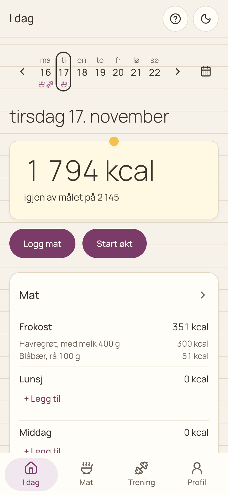
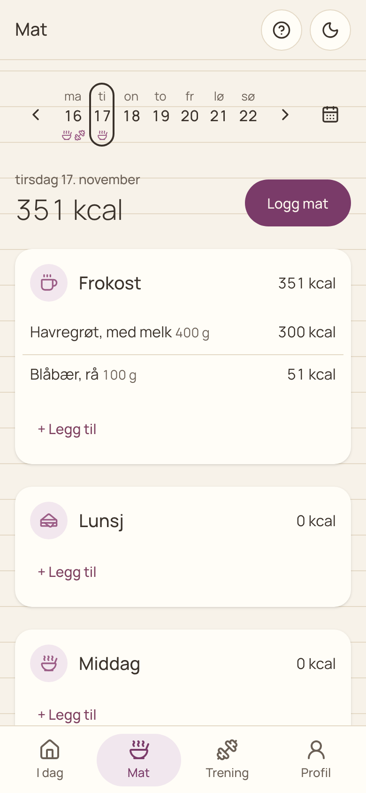
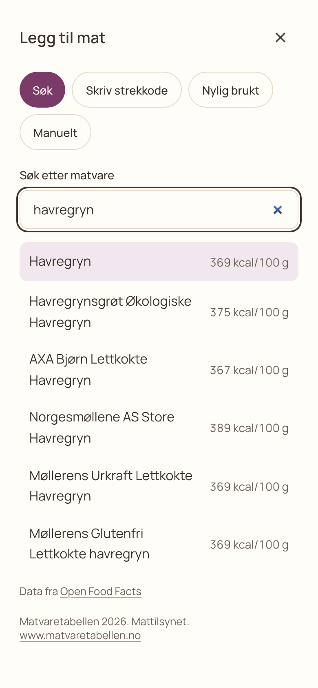
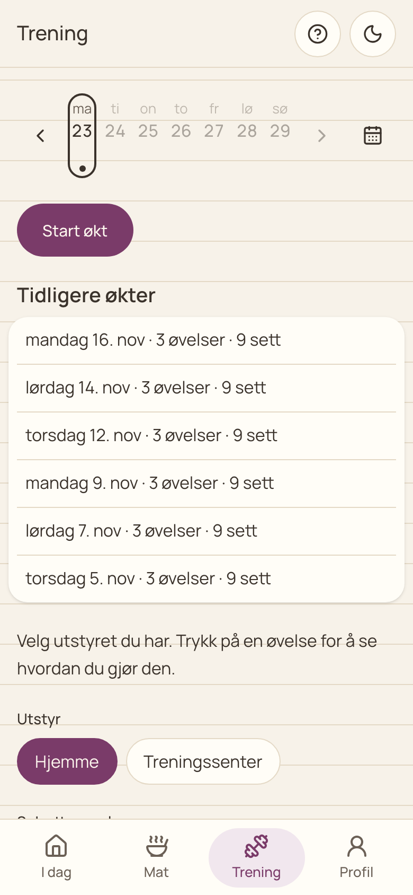
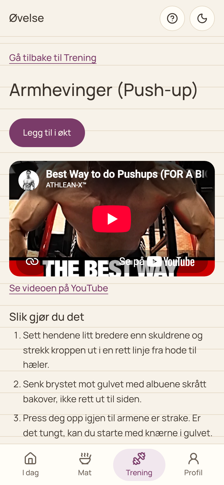

# G62 — Prompt Force

Gruppeprosjekt i **IBE160 Programmering med KI** ved Høgskolen i Molde, høsten 2026 (15 studiepoeng).

Repoet inneholder gruppens applikasjon og dokumentasjon av utvikling, testing og kvalitetssikring med KI.

## Applikasjon

Appen kjøres lokalt med Docker (se [Kom i gang](#kom-i-gang)). Den er ikke publisert på nett; det er ikke et krav i emnet.

## Medlemmer

- Karianne A Bjolstad
- Muhammad O Khalid
- Gustav Åbyholm Reehorst
- Fernando A Svendsrud

## Status

Alle Must-krav er ferdige, i tillegg til fire Should-stories: ukestripe (6.3), filtre på muskelgruppe og nivå (4.5), deaktivere konto (1.8) og glemt passord (1.7). Koden er bygget én story om gangen, med én branch og pull request per story. Se [sprint-status.yaml](.docs/implementation-artifacts/sprint-status.yaml) for status per story.

| Del | Status |
|---|---|
| Planlegging | Product brief, research, PRD, UX-design, arkitektur og 7 epics / 32 stories er ferdige |
| Konto (epic 1) | Opprett konto, logg inn/ut, samtykke, glemt passord, slett og deaktivere konto |
| Profil (epic 2) | Profiloppsett med daglig kaloribehov, endre profil |
| Mat (epic 3) | Søk (Matvaretabellen + 941 norske merkevarer fra Open Food Facts), strekkode, egne matvarer, porsjoner, endre/slette med angre |
| Trening (epic 4) | 34 øvelser med video (YouTube Shorts i stående spiller), utstyrsprofiler, forslag som passer utstyret, søk på navn, filtre på muskelgruppe og nivå |
| Treningslogg (epic 5) | Starte økt, logge sett (repetisjoner/kg eller sekunder), «Sist» fra forrige gang, fullføre, endre og slette økter |
| I dag (epic 6) | Kalorier igjen, dagens mat og trening, ukestripe for å bytte dag, tomme tilstander, «?»-hjelp, demobrukere og Playwright-tester |
| Ikke med | Se [Endret fra planen](#endret-fra-planen) |

### Skjermbilder

Demobrukeren Sara på mobilbredde (390 px). Bildene lages med `node frontend/scripts/screenshots.mjs` mens appen kjører.

| I dag | Mat | Søk etter mat | Trening | Øvelse |
|---|---|---|---|---|
|  |  |  |  |  |
| Story 6.1, 6.3 | Story 3.1, 3.6 | Story 3.1, 3.7 | Story 4.2, 4.3, 5.4 | Story 4.1 |

### Endret fra planen

Planen hadde 7 epics og 32 stories. Dette ble ikke med, og hvorfor:

| Story | Hvorfor ikke med |
|---|---|
| 3.8 Skanne strekkode med kamera (Should) | Kamera i nettleseren krever HTTPS når appen åpnes fra en mobil på nettverket, og appen kjører bare lokalt. «Skriv strekkode» dekker behovet. |
| 4.6 Muskelfigur (Should) | Trenger en tegnet kroppsfigur som ikke ble ferdig. Musklene vises som tekst på øvelsessiden. |
| Epic 7 Kalorier fra bilde | Planlagt som fase 2, bare når kjerneflyten var stabil. Krever en betalt KI-tjeneste med API-nøkkel, og appen skal virke uten nøkler. |

To ting kom i tillegg underveis: YouTube Shorts vises i en stående 9:16-spiller, og stories 6.1 og 6.2 ble slått sammen til én. Hver beslutning står i spec-filene i [`.docs/implementation-artifacts/`](.docs/implementation-artifacts/).

Oppgaver og åpne spørsmål følges opp i [GitHub Issues](https://github.com/IBE160-2026/G62-bjolstad-khalid-reehorst-svendsrud/issues).

## Kom i gang

Du trenger bare [Docker Desktop](https://www.docker.com/products/docker-desktop/) (Docker 24 eller nyere med Docker Compose v2). Du trenger ingen nøkler, kontoer eller betalte tjenester.

### API-nøkler

**Ingen API-nøkler trengs.**

- **Open Food Facts** (strekkoder) er et åpent API uten nøkkel. Som standard bruker appen en innebygd testversjon (`OFF_MODE=mock` i `.env`), så den virker uten nett. Med `OFF_MODE=live` spør den den ekte tjenesten (krever nett, ingen nøkkel).
- **Øvelsesvideoene** vises fra YouTube (youtube-nocookie) uten nøkkel. De krever nett.
- **E-post** (lenker for glemt passord) sendes aldri ut. Lokalt fanger [Mailpit](https://mailpit.axllent.org/) opp all e-post i en egen innboks, uten konto eller nøkkel (se «Glemt passord» under).
- **`SESSION_SECRET`** i `.env` har en trygg standardverdi for lokal kjøring og må bare byttes i produksjon.

```bash
git clone https://github.com/IBE160-2026/G62-bjolstad-khalid-reehorst-svendsrud.git
cd G62-bjolstad-khalid-reehorst-svendsrud
cp .env.example .env
docker compose up --build
```

Åpne <http://localhost:3000> når alle fire tjenestene kjører.

### Prøv appen

1. Trykk «Opprett konto» og lag en konto med e-post og passord (minst 8 tegn). Kontoen finnes bare i din lokale database.
2. Les samtykket og trykk «Godta og fortsett».
3. Fyll inn profilen (alder, kjønn, høyde, vekt, aktivitetsnivå) og se ditt daglige kaloribehov.
4. **Mat:** trykk «Logg mat», søk for eksempel «lettmelk» eller «havregryn», velg mengde og måltid. Trykk på en logget matvare for å endre eller slette den.
5. **Trening:** bytt mellom «Hjemme» og «Treningssenter» og se at forslagene endrer seg. Søk «knebøy», og åpne en øvelse for steg, video og muskler.
6. **Profil → Utstyr:** lag en egen utstyrsprofil, for eksempel «Hytta» med manualer, og se den på Trening.

### Glemt passord

Trykk «Glemt passord?» på innloggingssiden og skriv inn e-posten. Appen sender aldri ekte e-post: Compose-tjenesten `mailpit` fanger opp alle e-poster. Åpne innboksen på <http://localhost:8025> (ingen innlogging), åpne e-posten «Nytt passord til Prompt Force» og trykk på lenken. Lenken virker i 60 minutter og kan brukes én gang, og hver konto får høyst tre lenker i timen.

Ekte utsending krever en SMTP-server i `SMTP_*` i `.env`. Med `APP_ENV=production` nekter backenden å starte med `EMAIL_MODE=mock` eller tom `SMTP_HOST`. Testene sender aldri e-post (de bruker `EMAIL_MODE=mock`).

### Demobrukere

Vil du se appen med data med en gang, kan du logge inn med en av disse to oppdiktede brukerne. De har samtykket og fylt inn profilen, og har mat på de fleste av de siste 14 dagene og fullførte økter.

| E-post | Passord | Hva de viser |
|---|---|---|
| `sara@demo.test` | `Demo-passord-1` | Trener hjemme (Hjemme med manualer): armhevinger, knebøy og manualøvelse tre ganger i uka. Har logget frokost i dag, og én dag over målet. Start en økt med Armhevinger og se «Sist: …». |
| `jonas@demo.test` | `Demo-passord-2` | Trener på treningssenter: benkpress, knebøy med stang og markløft tre ganger i uka, med litt tyngre vekter hver uke. |

Demobrukerne lages bare når `APP_ENV=local`, aldri i produksjon. De lages én gang, ved første lokale oppstart, og datoene regnes fra den dagen. Sletter du en demokonto i appen, er den borte til du kjører `docker compose down -v` og starter på nytt, som også gir ferske data.

Matdata og øvelser lastes inn automatisk ved første oppstart. Appen trenger ikke nett, bortsett fra strekkodeoppslag mot Open Food Facts og YouTube-videoene.

- `db` (PostgreSQL), `backend` (FastAPI), `frontend` (Next.js) og `mailpit` (e-postfanger) starter med én kommando. Port 3000 (appen) og 8025 (e-postinnboksen, bare fra din egen maskin) er åpne; nettleseren når backenden via `/api` på samme adresse.
- Databasemigreringer kjøres automatisk når backenden starter.
- Første oppstart laster ned images og pakker og tar noen minutter.
- Stopp med `Ctrl+C` eller `docker compose down`. `docker compose down -v` sletter også databasen.
- `.env.example` har trygge standardverdier for lokal kjøring. `.env` skal aldri committes. Med `APP_ENV=production` nekter backenden å starte hvis `SESSION_SECRET` er tom eller standardverdien.

## Tester

Med appen i gang (`docker compose up`) kjører alle testene i containerne, så du trenger bare Docker:

```bash
# Backend (pytest mot en egen testdatabase, promptforce_test)
docker compose exec backend pytest -q

# Frontend (Vitest og ESLint)
docker compose exec frontend npm run test -- --run
docker compose exec frontend npm run lint
```

Finner ikke backend-testene `promptforce_test`, ble databasevolumet laget før story 1.1. Kjør `docker compose down -v` én gang (sletter lokale data) og start på nytt.

Alternativ uten Docker for frontend (krever Node.js 24): `cd frontend && npm install && npm run test -- --run && npm run lint`.

### Ende-til-ende-tester (Playwright)

Playwright kjører hovedflyten i appen i en ekte Chromium mot appen på `http://localhost:3000`: registrering, samtykke og profil (UJ-1), mat via søk og strekkode (UJ-2), en økt hjemme og «Sist» for Sara (UJ-3), I dag med måltider og økt (UJ-4), glemt passord med lenken lest fra Mailpit, ingen sidelengs scrolling på 360 px og fokus/Esc i arkene. Testene kjører på maskinen din (krever Node.js 24), ikke i containeren. Start appen først:

```bash
docker compose up --build -d
cd frontend && npm ci && npx playwright install chromium && npm run test:e2e
```

`npx playwright install chromium` laster ned nettleseren én gang. Hver test lager sin egen bruker (`e2e-…@demo.test`), så testene kan kjøres flere ganger på samme database. En annen adresse settes med `E2E_BASE_URL`. Resultater og spor fra feilede tester havner i `frontend/e2e/test-results/` (ignorert av git). `npm run test` (Vitest) og `npm run build` kjører ikke disse testene.

## Utvikling

API-typene i frontend genereres fra backendens OpenAPI-skjema og committes. Når API-et endres:

```bash
# 1. Skriv backend/openapi.json (krever uv: https://docs.astral.sh/uv/)
cd backend
uv run python scripts/export_openapi.py

# 2. Generer frontend/src/lib/api/schema.d.ts
cd ../frontend
npm run gen:api
```

Endringer i koden krever at containerne bygges på nytt: `docker compose up --build`.

### Oppdatere matdata

Søket finner norske merkevarer fra Open Food Facts uten nett, fordi de ligger i den committede seed-fila `backend/app/seed/data/off_norway.json` (ODbL, se `OFF_LICENSE.md` i samme mappe). Fila lastes inn ved oppstart med `APP_ENV=local`. For å hente de 1 000 mest skannede norske varene på nytt (krever nett; minst ca. 1 minutt fordi OFF tillater maks 10 søk i minuttet, men opptil 10–15 minutter når OFF svarer «503», fordi hver side prøves 3 ganger med 30 sekunders pause):

```bash
cd backend
uv run python -m app.cli import-off-norway
```

Kommandoen skriver `Fetched N products, kept M.` og endrer ingenting hvis en side feiler. Sidene som allerede er hentet, ligger i `backend/.off_import_cache/` (ikke i git), så neste kjøring henter bare de som mangler. Commit de to oppdaterte filene.

En database som allerede har varene, får ikke nye verdier for dem ved oppstart (bare nye strekkoder legges til). For å ta inn rettede verdier lokalt: `docker compose down -v` og start på nytt (sletter lokale testdata).

## Dokumentasjon

**Planlegging (BMAD)**
- [Product brief](.docs/planning-artifacts/briefs/brief-prompt-force-2026-09-16/) med tilbakemelding fra faglærer
- [PRD](.docs/planning-artifacts/prds/prd-prompt-force-2026-11-02/prd.md), med [tillegg](.docs/planning-artifacts/prds/prd-prompt-force-2026-11-02/addendum.md) (datamodell og tekniske detaljer)
- [Research](.docs/planning-artifacts/research/): trening, GDPR, datalisenser, strekkode, innlogging, Open Food Facts-dekning, [strekkodetest med varer hjemme](.docs/planning-artifacts/research/strekkodetest-fysiske-varer-2026-11-13/research.md) og forslag til teknologivalg
- [Øvelsesliste](.docs/planning-artifacts/ovelsesliste.md) og [gjennomgang med forslag til nye øvelser](.docs/planning-artifacts/ovelsesliste-gjennomgang-2026-11-11.md)

**UX-design**
- [Produktbeskrivelse for design](PRODUCT.md)
- **Felles design (gjeldende):** [DESIGN.md og EXPERIENCE.md](.docs/planning-artifacts/ux-designs/ux-prompt-force-2026-11-10/)
- Prosessen: [konseptrunder og beslutninger](.docs/planning-artifacts/ux/konsepter/decisions.md), [valgt konsept A1](.docs/planning-artifacts/ux/valgt-konsept/), [runde 3 med mockups](.docs/planning-artifacts/ux/runde-3/)

**Prosess og KI-bruk**
- [KI-logg](.docs/ki-logg.md): hva vi ba KI om, hva den laget, og hva vi selv kontrollerte og endret
- [Sesjonslogger](.logs/): én mappe per gruppemedlem, med åpne punkter i `issues.md`
- [Retro for hele prosjektet](.docs/implementation-artifacts/prosjekt-retro-2026-11-18.md) og [utsatt arbeid](.docs/implementation-artifacts/deferred-work.md)
- [Utkast til metodevalg](.docs/rapport-metodevalg.md) for refleksjonsrapporten

**Emnet**
- [Sensorveiledning del 1 – applikasjon og prosess](.docs/course/sensorveiledning-del1-applikasjon-og-prosess.pdf): vurderingskriteriene repoet skal oppfylle

## Mappestruktur

| Mappe | Innhold |
|---|---|
| `backend/` | FastAPI-backend: `app/` (core, moduler, porter, seed), Alembic-migreringer og tester |
| `frontend/` | Next.js-frontend: `src/app/`, `src/modules/`, generert API-klient i `src/lib/api/` og `e2e/` |
| `db/init/` | Oppstartsskript for PostgreSQL (oppretter testdatabasen) |
| `frontend/scripts/` | Skript som lager skjermbildene i README |
| `.docs/implementation-artifacts/` | Sprint-status, én spec per story (med review-funn), retro og utsatt arbeid |
| `.docs/skjermbilder/` | Skjermbildene i README |
| `.docs/planning-artifacts/` | Brief, PRD, research, UX-design og øvelsesliste |
| `.docs/course/` | Dokumenter fra emnet |
| `.logs/` | Sesjonslogger per gruppemedlem |
| `_bmad/`, `.claude/` | BMAD-rammeverket og KI-skills som brukes i prosjektet |
| `CLAUDE.md` | Faste instruksjoner til KI-agenten (blant annet sesjonslogg) |
| `PRODUCT.md` | Produktbeskrivelse som designskillen (`impeccable`) leser |
| `.impeccable/` | Innstillinger og spørsmål for `impeccable`-skillen |
| `docker-compose.yml`, `.env.example` | Oppstart av hele appen og trygge standardverdier |
